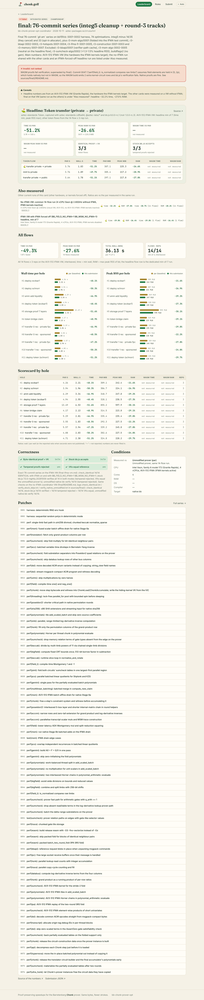
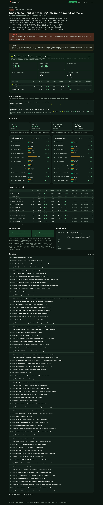
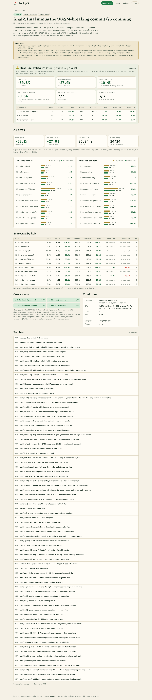
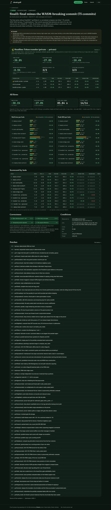

# chonk.golf

A [zk.golf](https://zk.golf)-style leaderboard for **proof-preserving Barretenberg Chonk prover optimisations**
(the `bb-chonk-prover-opt` effort; its results snapshot is in [`sources/`](sources/)). Fewer strokes (seconds, MiB), same bytes: a card only counts if the prover's output is unchanged.

**Headline flow:** the board ranks by one flow first — a private → private transfer of the
[aztec-standards](https://github.com/AztecProtocol/aztec-standards) Token (`standards_token_transfer_private_to_private`),
captured with aztec-standards' own 6.0.0-rc.1 toolchain ([`flows-standards/README.md`](flows-standards/README.md)) —
with time and peak RAM side by side. The 5/11 pinned-flow totals are secondary columns; cards measured before the
headline benchmark existed show "not measured". RAM must not grow.

Golf mapping: the 11 pinned Chonk flows are the **holes**, the unmodified prover is **par**, a submission is a
**card**. Full patch series measured against the unmodified prover play the **Championship**; single-track
contributions measured against their own start point are marginal gains on the **Driving range**.

Static site: React 19 + TypeScript + Tailwind 4 on **Vite+** (`vp`). Data is bundled JSON, validated with zod at
build time. No server. Deploys to Cloudflare with the `cf` CLI — see [Deploy](#deploy-cloudflare-cf-cli).

## Play

The home page starts with a **“Play chonk.golf with your agent”** card: a copy-paste prompt (also at `/prompt`, raw at
`/prompt.md`) that sends anyone's coding agent off to beat the current #1 using only this public repo (the prompt
never names the leader, since it changes). Rule #1
of the prompt, and of the board: **the verifier must match.**

## Run

```bash
pnpm install
vp dev                 # http://localhost:5173
pnpm run build         # vp run app:build -> data:validate, tsc, vp build -> .cloudflare/output/
vp preview             # built site in the local Workers runtime (workerd), http://localhost:4173
vp check               # format + lint + typecheck
vp test                # schema/data/scoring tests
pnpm run screenshots   # needs a running preview; CHROMIUM_PATH=/opt/pw-browsers/chromium-1194/chrome-linux/chrome
harness/selftest.sh    # harness end-to-end with a mock bb
```

## Deploy (Cloudflare, `cf` CLI)

The site is fully static and deploys as a **Workers static-assets** project (no Worker script) with the
[`cf` CLI](https://blog.cloudflare.com/cloudflare-cf-cli-launch/) (`cf@1.0.0-beta.14`, a devDependency):

- `cloudflare.config.ts` — Worker config (`defineConfig` from `cf/config`): name, compatibility date, SPA
  fallback, observability, commented-out custom domain.
- `@cloudflare/vite-plugin` in `vite.config.ts` — makes `vp build` emit the
  [Build Output](https://developers.cloudflare.com/workers/) in `.cloudflare/output/`, and makes `vp preview` /
  `vp dev` run in workerd so `_headers` and routing behave as in production.
- `public/_headers` — strict CSP (no inline scripts, no third-party origins), `immutable` caching for hashed
  `/assets/*`, revalidation for `index.html`.

Routes are real URLs (`/`, `/s/<id>`, `/rules`, `/submit`), handled client-side; Cloudflare's SPA fallback
(`notFoundHandling: "single-page-application"`) serves `index.html` for them. Old `#/…` links are rewritten on load.

```bash
pnpm install
npx cf auth login          # once (CI: set CLOUDFLARE_API_TOKEN instead)
pnpm run deploy:check      # build + validate + `cf deploy --prebuilt --dry-run`
pnpm run deploy            # build + `cf deploy --prebuilt`  ->  https://chonk-golf.<account>.workers.dev
```

`--prebuilt` deploys the output of `vp run app:build`, which validates every card in `data/submissions/` and
typechecks first, so invalid data never ships.

**From Git (Workers Builds)**: Cloudflare dashboard → Workers & Pages → Create → Import a repository →
`olehmisar/chonk-golf`, then:

| Setting           | Value                                                                                               |
| ----------------- | --------------------------------------------------------------------------------------------------- |
| Build command     | `pnpm install --frozen-lockfile && pnpm run build`                                                  |
| Deploy command    | `npx cf deploy --prebuilt`                                                                          |
| Production branch | `main`                                                                                              |
| Build env vars    | optional `VITE_GITHUB_REF` (git ref that "Submission JSON" / schema links point at; default `main`) |

Node is pinned with `.node-version` (22.22.0; the data validator needs ≥ 22.18 for TypeScript type stripping).

**Custom domain**: once the `chonk.golf` zone is on Cloudflare, uncomment `routes` in `cloudflare.config.ts` and
redeploy.

## Rules (shown on the site)

1. Applies to aztec-packages `bb15fcb` (pinned) as a `git am` patch series.
2. **Byte-identical output**: with `BB_DETERMINISTIC_PROVING=42`, proof and VK SHA-256 for all 11 pinned flows equal
   `reference/proof_vk_sha256.txt`.
3. **Unmodified verifier accepts**: with real randomness, all 11 proofs verify under stock npm
   `@aztec-foundation/bb.js@7.0.0-nightly.20261009`, tampered proofs are rejected, VKs equal the reference.
4. Scored on wall-clock proving time and **peak RSS** per flow against the unmodified baseline on the same machine
   (interleaved, min of N), plus the machine description.

Scoring: time vs par = Σ min wall / Σ par min wall (the reported summary total when per-flow seconds were not
published); speedup = 1 / that. RAM vs par = Σ per-flow peak RSS / Σ par peak RSS over flows with both numbers.
_Verified_ = 11/11 identical and 11/11 stock bb.js; _Identical_ = 11/11 identical only.

## Layout

| Path                                                                 | What                                                                                                                                                                  |
| -------------------------------------------------------------------- | --------------------------------------------------------------------------------------------------------------------------------------------------------------------- |
| `src/schema.ts`                                                      | zod schema of a submission (single source of truth)                                                                                                                   |
| `data/submission.schema.json`                                        | generated JSON Schema (rewritten by `pnpm run validate`)                                                                                                              |
| `data/submissions/*.json`                                            | one card per file; file name = `id`                                                                                                                                   |
| `sources/<id>/submission.json`                                       | participant cards: a submission PR adds one `sources/<id>/` folder (full patch series + harness JSON)                                                                 |
| `scripts/validate-data.ts`                                           | build-time validation (task `data:validate`, a dependency of `app:build`)                                                                                             |
| `scripts/seed-from-results.py`                                       | regenerates the seed cards from `sources/` (numbers transcribed by hand)                                                                                              |
| `scripts/screenshots.mjs`                                            | Playwright screenshots of every page                                                                                                                                  |
| `harness/`                                                           | correctness + benchmark harness that emits a card — see [`harness/README.md`](harness/README.md)                                                                      |
| `src/components/ProgressChart.tsx`, `src/progress.ts`                | leaderboard progress chart: headline / all-flows time and peak RAM vs par for par → integ1-5 → final2 (final is invalid) (`milestone`, `common_run` in the data)      |
| `src/pages/`                                                         | Leaderboard (with the “Play with your agent” card), Submission detail, Rules, Submit, Prompt                                                                          |
| `src/prompt-template.md`                                             | participant prompt (static text, never names the leader); served raw at `/prompt.md`                                                                                  |
| `sources/`                                                           | bb-chonk-prover-opt results snapshot: integrated series, patches, per-track RESULTS.md (what the cards cite)                                                          |
| `reference/`                                                         | proof/VK SHA-256 of the unmodified prover for the 11 flows, baseline timings (from bb-chonk-prover-opt)                                                               |
| `patches/`                                                           | the two harness patches (seeded RNG) every build applies on bb15fcb                                                                                                   |
| `scripts/setup.sh`                                                   | builds par (`--harness-only`) or a series (`sources/<id>` [+ your patches]) and downloads the 11 pinned flows                                                         |
| `scripts/check_identical.sh`, `ab.sh`, `native_verify_unmodified.sh` | identity check (`FLOWS`/`REF` overrides), interleaved A/B, unmodified `bb verify`                                                                                     |
| `ts-verify/`                                                         | stock npm bb.js verify (`stock_bbjs_verify.mjs`); one WASM prove + bundled-WASM verify (`wasm_prove_once.mjs`), driven by `scripts/wasm_ab.py` (interleaved WASM A/B) |
| `flows-standards/`                                                   | the headline aztec-standards Token flows: inputs (`.msgpack.gz`), `unpack.sh`, reference hashes, capture script, README                                               |
| `cloudflare.config.ts`, `public/_headers`, `.node-version`           | Cloudflare deployment (`cf` CLI)                                                                                                                                      |

## Seed data

Series cards (baseline, integ1-5, final) come from **one** run of all 14 flows (11 pinned + 3 aztec-standards) on the
same machine (`sources/final/bench_14flows_4vcpu.json`: 7 binaries round-robin, order shuffled, 5 reps; time = min
wall, RAM = median peak RSS). Their earlier 5-flow numbers are kept under `history` and shown as "Earlier
measurements". `final2` (final minus the WASM-breaking commit, `sources/final2/`) was measured in a later 14-flow run on
the same VM type with its own unmodified baseline, plus the first WASM benchmark (5 flows, stock bb.js). `final` is
marked `invalid` (its WASM proofs fail verification): it stays on the board for the record but is never ranked. Track
cards keep their own reported numbers and flow counts.

All numbers are transcribed from the published results; anything not reported is `null` and shows as “—”.

| Card                                                | Board                                                | Source                                                                              | Time                                                          | Peak RSS                                  |
| --------------------------------------------------- | ---------------------------------------------------- | ----------------------------------------------------------------------------------- | ------------------------------------------------------------- | ----------------------------------------- |
| `baseline`                                          | par                                                  | common 14-flow run (`sources/final/`)                                               | 14 flows (par)                                                | 14 flows (par)                            |
| `own-0003-0006`                                     | championship                                         | README.md, STATUS.md                                                                | not reported                                                  | 2 flows                                   |
| `integ1`                                            | championship                                         | common 14-flow run                                                                  | ⛳ −11.0% · all −14.2%                                        | ⛳ −0.1% · all +0.1%                      |
| `integ2`                                            | championship                                         | common 14-flow run                                                                  | ⛳ −22.5% · all −21.0%                                        | ⛳ +4.6% · all +6.4% (flagged)            |
| `integ3`                                            | championship                                         | common 14-flow run                                                                  | ⛳ −24.3% · all −25.1%                                        | ⛳ +4.5% · all +6.3% (flagged)            |
| `integ4`                                            | championship                                         | common 14-flow run (+ RSS bisect)                                                   | ⛳ −32.9% · all −29.9%                                        | ⛳ +4.8% · all +8.8% (flagged)            |
| `integ5`                                            | championship                                         | common 14-flow run                                                                  | ⛳ −26.3% · all −29.1%                                        | ⛳ −14.4% · all −9.8%                     |
| `final`                                             | championship (invalid: WASM proofs fail, not ranked) | AVX-512 IFMA VM (`sources/final/final-ifma-vm.md`); no-IFMA common run as alternate | ⛳ −51.2% · all −49.3% (IFMA); no-IFMA ⛳ −32.2% · all −30.7% | ⛳ −26.6% · all −27.6%                    |
| `final2`                                            | championship (leader)                                | own 14-flow run + WASM bench (`sources/final2/`)                                    | **⛳ −30.8% · all −30.1%**; WASM ⛳ −10.4% · 5 flows −16.4%   | **⛳ −27.0% · all −27.0%**; WASM ⛳ −0.5% |
| `track-msm2`                                        | range                                                | `contrib/msm2/RESULTS.md`                                                           | −16.4% (11 flows, IFMA VM)                                    | —                                         |
| `track-circuit`                                     | range                                                | `contrib/circuit/RESULTS.md`                                                        | −4.4% (11 flows, seconds)                                     | —                                         |
| `track-threading`                                   | range                                                | `contrib/threading/RESULTS.md`                                                      | −3.7% (11 flows, seconds)                                     | —                                         |
| `track-fields2`                                     | range                                                | `contrib/fields2/RESULTS.md`                                                        | −3.7% (vs integ2)                                             | —                                         |
| `track-fields`                                      | range (withdrawn)                                    | `contrib/fields/RESULTS.md`                                                         | −3.3% (dup. of msm/0001)                                      | —                                         |
| `track-eccvm`                                       | range                                                | `contrib/eccvm/RESULTS.md`                                                          | −2.5% (11 flows, seconds)                                     | —                                         |
| `track-instance`                                    | range                                                | `contrib/instance/RESULTS.md`                                                       | −2.3% (11 flows, total)                                       | —                                         |
| `track-wasm`                                        | range                                                | `contrib/wasm/RESULTS.md`                                                           | −2.1% (WASM, 1 flow)                                          | —                                         |
| `track-sumcheck`                                    | range                                                | `contrib/sumcheck/RESULTS.md`                                                       | −2.1% (11 flows, seconds)                                     | —                                         |
| `track-pcs`                                         | range                                                | `contrib/pcs/RESULTS.md`                                                            | −1.7% (5 flows, prelim.)                                      | —                                         |
| `track-transcript`                                  | range                                                | `contrib/transcript/RESULTS.md`                                                     | −1.6% (11 flows, seconds)                                     | —                                         |
| `track-msm`                                         | range                                                | `contrib/msm/RESULTS.md`                                                            | −0.9% (11 flows; 4-flow table)                                | —                                         |
| `track-joint`                                       | range                                                | `contrib/joint/RESULTS.md`                                                          | ±0 (11 flows)                                                 | —                                         |
| `track-pipeline`, `track-stdlib`, `track-sumcheck2` | range                                                | RESULTS.md (WIP)                                                                    | not reported                                                  | —                                         |

Every patch and source link points at the snapshot in [`sources/`](sources/): the integrated series and
coordinator patches (`sources/integrated/`, `sources/patches/`) and each track's patches and RESULTS.md
(`sources/contrib/<track>/`), at the versions the cards were transcribed from. `buildflags/0001` is covered by integ3 only (its 0.947 allocator screen used
LD_PRELOAD, not the patch's default build, so it has no card).

## Screenshots

Taken with Playwright/Chromium against `vp preview` (`docs/screenshots/`; desktop 1360 px, mobile 390 px).

| Page                        | Desktop (light)                                        | Desktop (dark)                                              | Mobile                                                |
| --------------------------- | ------------------------------------------------------ | ----------------------------------------------------------- | ----------------------------------------------------- |
| Leaderboard                 |           |           |           |
| Leaderboard · driving range |     |     |     |
| Leaderboard · peak RAM      |       |       |       |
| Submission: final           |      |      |      |
| Submission: final2          |     |     |     |
| Submission: threading       |  |  |  |
| Rules                       |                 |                 |                 |
| How to submit               |                |                |                |

## Notes

- zk.golf itself only exposed its title to the fetcher, so the design is from first principles: mowed-fairway hero,
  golf-score deltas (“−24.2%”, “E” for even), scorecard-by-hole tables.
- Chart colours (par = sand `#a8862f`/`#a37b28`, card = fairway `#1f7a45`/`#199e70`) pass the dataviz palette
  validator (lightness, chroma, CVD, contrast) in both themes; bars are also direct-labelled.
- The theme toggle (Auto/Light/Dark) is stored in `localStorage` with a try/catch fallback.
