# chonk.golf

A [zk.golf](https://zk.golf)-style leaderboard for **proof-preserving Barretenberg Chonk prover optimisations**
(the [`bb-chonk-prover-opt`](https://github.com/olehmisar/playground/tree/claude/nice-sagan-f00j9v/bb-chonk-prover-opt)
effort). Fewer strokes (seconds, MiB), same bytes: a card only counts if the prover's output is unchanged.

Golf mapping: the 11 pinned Chonk flows are the **holes**, the unmodified prover is **par**, a submission is a
**card**. Full patch series measured against the unmodified prover play the **Championship**; single-track
contributions measured against their own start point are marginal gains on the **Driving range**.

Static site: React 19 + TypeScript + Tailwind 4 on **Vite+** (`vp`). Data is bundled JSON, validated with zod at
build time. No server. Ready to deploy on Cloudflare (Workers static assets) — see [Deploy](#deploy-cloudflare).

## Run

```bash
cd chonk-golf
pnpm install
vp dev                 # http://localhost:5173
pnpm run build         # vp run app:build -> data:validate, tsc, vp build -> dist/
vp preview             # http://localhost:4173
vp check               # format + lint + typecheck
vp test                # schema/data/scoring tests
pnpm run screenshots   # needs a running preview; CHROMIUM_PATH=/opt/pw-browsers/chromium-1194/chrome-linux/chrome
harness/selftest.sh    # harness end-to-end with a mock bb
```

## Deploy (Cloudflare)

The site is fully static, so it is served by **Cloudflare Workers static assets** (no Worker script).
Config lives in `wrangler.jsonc`; `public/_headers` sets security headers (strict CSP: no inline scripts, no
third-party origins), `immutable` caching for hashed `/assets/*`, and revalidation for `index.html`.
Routing is hash-based (`#/s/<id>`), so no rewrite rules are needed.

**From your machine**

```bash
cd chonk-golf
pnpm install
npx wrangler login         # once
pnpm run cf:preview        # build + serve dist/ in the local Workers runtime (http://localhost:8787)
pnpm run deploy            # build + wrangler deploy  ->  https://chonk-golf.<account>.workers.dev
pnpm run deploy:preview    # upload a version with a preview URL, without promoting it
```

**From Git (Workers Builds)**: Cloudflare dashboard → Workers & Pages → Create → Import a repository →
`olehmisar/playground`, then:

| Setting                       | Value                                                                                               |
| ----------------------------- | --------------------------------------------------------------------------------------------------- |
| Root directory                | `chonk-golf`                                                                                        |
| Build command                 | `pnpm install --frozen-lockfile && pnpm run build`                                                  |
| Deploy command                | `npx wrangler deploy`                                                                               |
| Non-production deploy command | `npx wrangler versions upload`                                                                      |
| Production branch             | `main`                                                                                              |
| Build env vars                | optional `VITE_GITHUB_REF` (git ref that "Submission JSON" / schema links point at; default `main`) |

Node is pinned with `.node-version` (22.22.0; the data validator needs ≥ 22.18 for TypeScript type stripping).
The build fails if any card in `data/submissions/` is invalid.

**Custom domain**: once the `chonk.golf` zone is on Cloudflare, uncomment the `routes` entry in `wrangler.jsonc`
(`{ "pattern": "chonk.golf", "custom_domain": true }`) and redeploy.

Pages works too if preferred: `npx wrangler pages deploy dist --project-name chonk-golf` (same `_headers` file).

## Rules (shown on the site)

1. Applies to aztec-packages `bb15fcb` (pinned) as a `git am` patch series.
2. **Byte-identical output**: with `BB_DETERMINISTIC_PROVING=42`, proof and VK SHA-256 for all 11 pinned flows equal
   `reference/proof_vk_sha256.txt`.
3. **Unmodified verifier accepts**: with real randomness, all 11 proofs verify under stock npm
   `@aztec-foundation/bb.js@7.0.0-nightly.20261009`, tampered proofs are rejected, VKs equal the reference.
4. Scored on wall-clock proving time and **peak RSS** per flow against the unmodified baseline on the same machine
   (interleaved, min of N), plus the machine description.

Scoring: time vs par = Σ min wall / Σ par min wall (the reported summary total when per-flow seconds were not
published); speedup = 1 / that. RAM vs par = Σ per-flow peak RSS / Σ par peak RSS over flows with both numbers.
_Verified_ = 11/11 identical and 11/11 stock bb.js; _Identical_ = 11/11 identical only.

## Layout

| Path                           | What                                                                                             |
| ------------------------------ | ------------------------------------------------------------------------------------------------ |
| `src/schema.ts`                | zod schema of a submission (single source of truth)                                              |
| `data/submission.schema.json`  | generated JSON Schema (rewritten by `pnpm run validate`)                                         |
| `data/submissions/*.json`      | one card per file; file name = `id`                                                              |
| `scripts/validate-data.ts`     | build-time validation (task `data:validate`, a dependency of `app:build`)                        |
| `scripts/seed-from-results.py` | how the seed cards were transcribed (re-run after `git fetch` of the track branches)             |
| `scripts/screenshots.mjs`      | Playwright screenshots of every page                                                             |
| `harness/`                     | correctness + benchmark harness that emits a card — see [`harness/README.md`](harness/README.md) |
| `src/pages/`                   | Leaderboard, Submission detail, Rules, Submit                                                    |

## Seed data

All numbers are transcribed from the published results; anything not reported is `null` and shows as “—”.

| Card                                                | Board             | Source                                          | Time                           | Peak RSS        |
| --------------------------------------------------- | ----------------- | ----------------------------------------------- | ------------------------------ | --------------- |
| `baseline`                                          | par               | `reference/baseline_times_4core.txt`, STATUS.md | 11 flows, single run           | 2 flows         |
| `own-0003-0006`                                     | championship      | README.md, STATUS.md                            | not reported                   | 2 flows         |
| `integ1`                                            | championship      | `integrated/STATUS.md`                          | −15.1% (5 flows, ratios)       | 2 flows (+0.4%) |
| `integ2`                                            | championship      | `integrated/STATUS.md`                          | −23.7% (5 flows, ratios)       | 2 flows (+4.6%) |
| `integ3`                                            | championship      | `integrated/STATUS.md`                          | **−24.2%** (5 flows, ratios)   | 2 flows (+5.0%) |
| `track-msm2`                                        | range             | `contrib/msm2/RESULTS.md`                       | −16.4% (11 flows, IFMA VM)     | —               |
| `track-circuit`                                     | range             | `contrib/circuit/RESULTS.md`                    | −4.4% (11 flows, seconds)      | —               |
| `track-threading`                                   | range             | `contrib/threading/RESULTS.md`                  | −3.7% (11 flows, seconds)      | —               |
| `track-fields2`                                     | range             | `contrib/fields2/RESULTS.md`                    | −3.7% (vs integ2)              | —               |
| `track-fields`                                      | range (withdrawn) | `contrib/fields/RESULTS.md`                     | −3.3% (dup. of msm/0001)       | —               |
| `track-eccvm`                                       | range             | `contrib/eccvm/RESULTS.md`                      | −2.5% (11 flows, seconds)      | —               |
| `track-instance`                                    | range             | `contrib/instance/RESULTS.md`                   | −2.3% (11 flows, total)        | —               |
| `track-wasm`                                        | range             | `contrib/wasm/RESULTS.md`                       | −2.1% (WASM, 1 flow)           | —               |
| `track-sumcheck`                                    | range             | `contrib/sumcheck/RESULTS.md`                   | −2.1% (11 flows, seconds)      | —               |
| `track-pcs`                                         | range             | `contrib/pcs/RESULTS.md`                        | −1.7% (5 flows, prelim.)       | —               |
| `track-transcript`                                  | range             | `contrib/transcript/RESULTS.md`                 | −1.6% (11 flows, seconds)      | —               |
| `track-msm`                                         | range             | `contrib/msm/RESULTS.md`                        | −0.9% (11 flows; 4-flow table) | —               |
| `track-joint`                                       | range             | `contrib/joint/RESULTS.md`                      | ±0 (11 flows)                  | —               |
| `track-pipeline`, `track-stdlib`, `track-sumcheck2` | range             | RESULTS.md (WIP)                                | not reported                   | —               |

Patch links point at the files on `claude/nice-sagan-f00j9v` (integrated series, own patches) and
`claude/bbopt-<track>` (track patches). `buildflags/0001` is covered by integ3 only (its 0.947 allocator screen used
LD_PRELOAD, not the patch's default build, so it has no card).

## Screenshots

Taken with Playwright/Chromium against `vp preview` (`docs/screenshots/`; desktop 1360 px, mobile 390 px).

| Page                        | Desktop (light)                                        | Desktop (dark)                                              | Mobile                                                |
| --------------------------- | ------------------------------------------------------ | ----------------------------------------------------------- | ----------------------------------------------------- |
| Leaderboard                 | 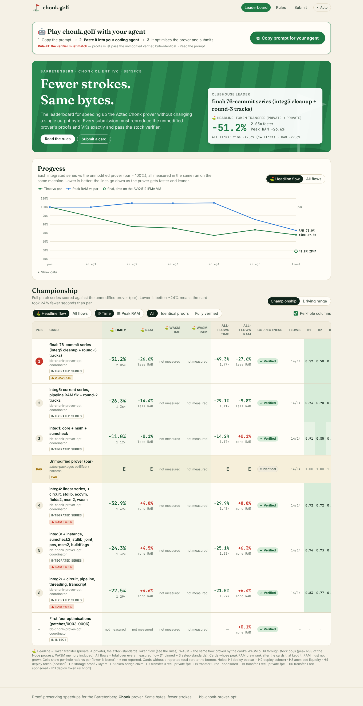          | 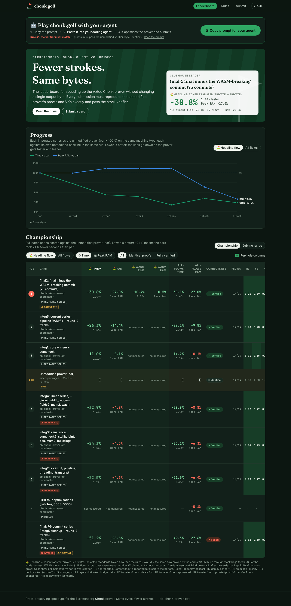          | 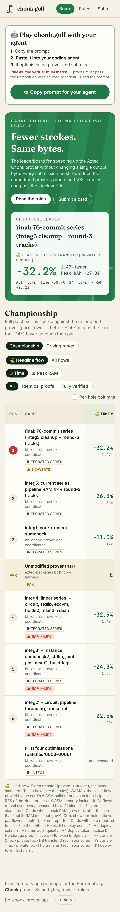          |
| Leaderboard · driving range | 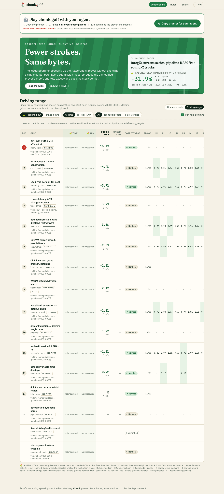    | 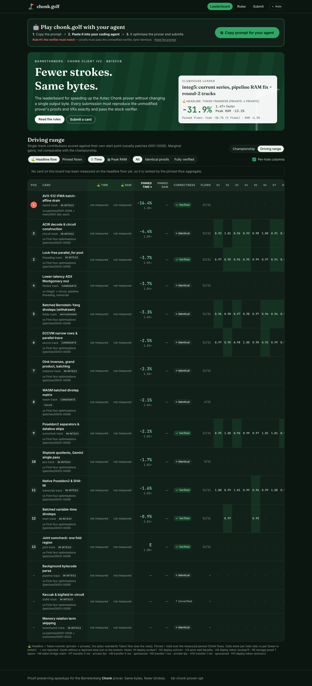    | 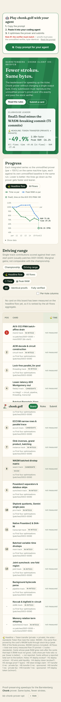    |
| Leaderboard · peak RAM      | 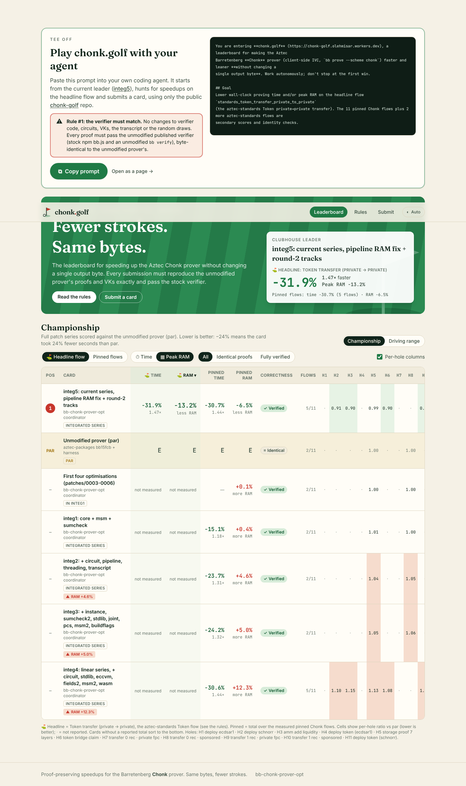      | 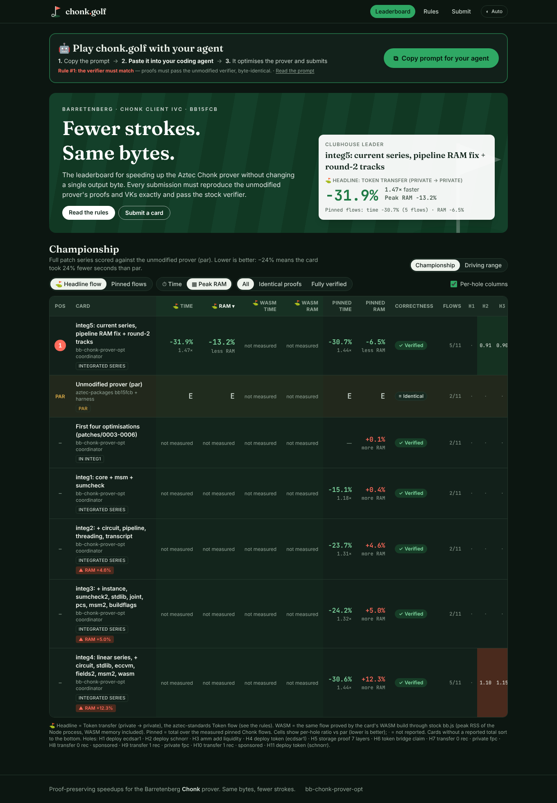      | 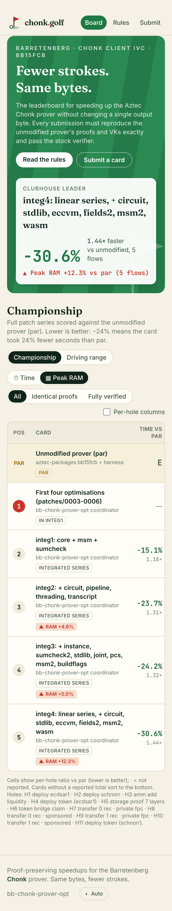      |
| Submission: integ3          | 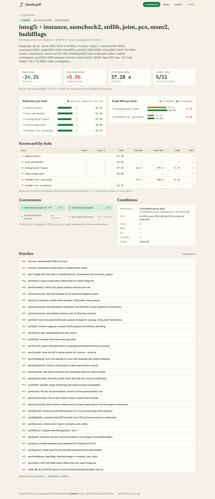    | 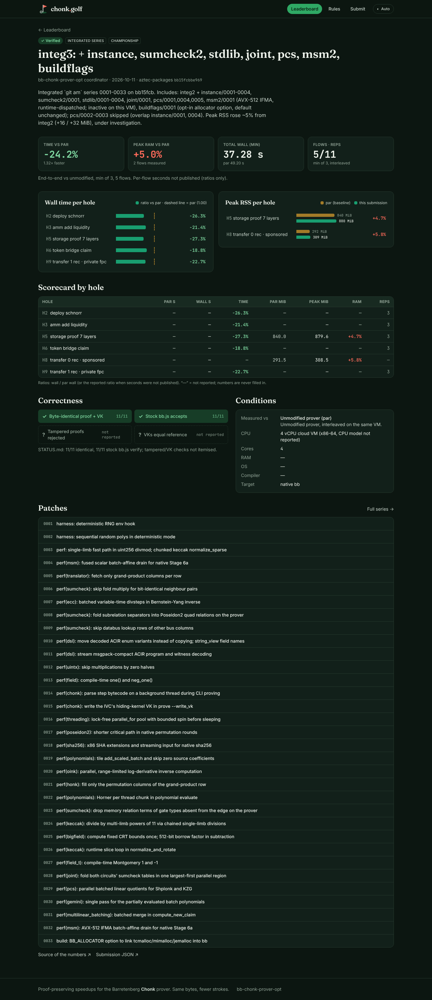    | 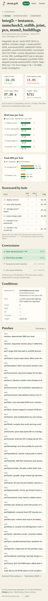    |
| Submission: threading       | 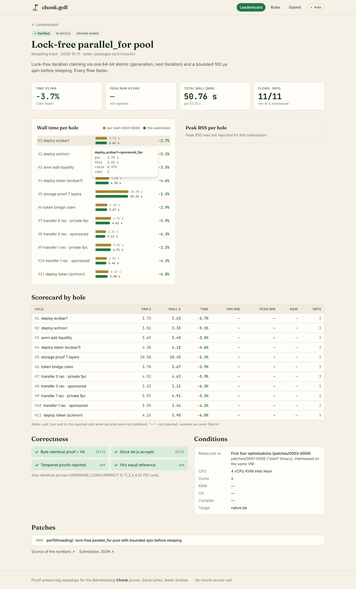 | 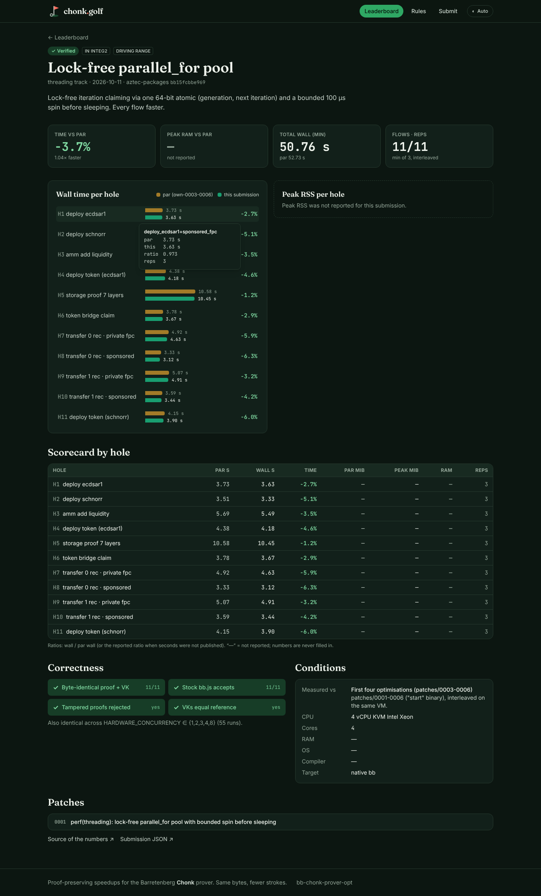 | 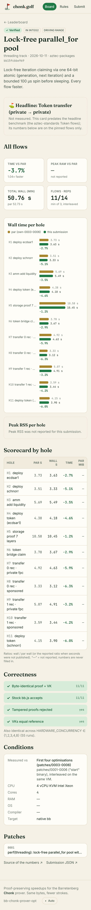 |
| Rules                       | 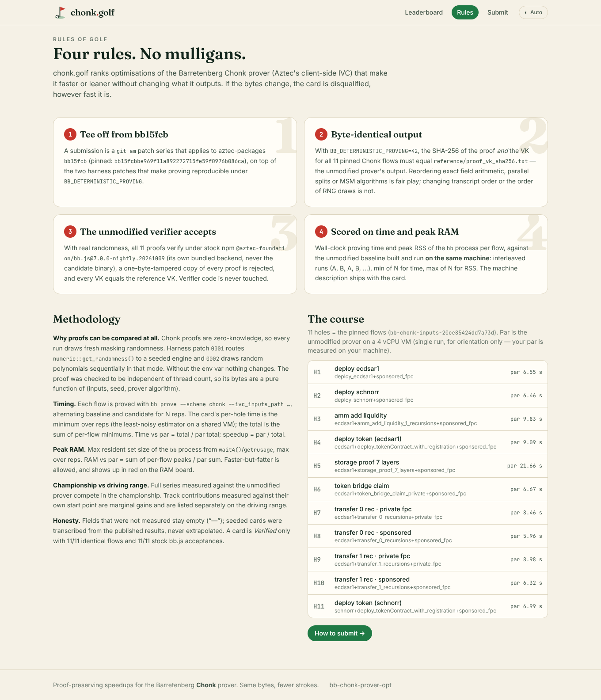                | 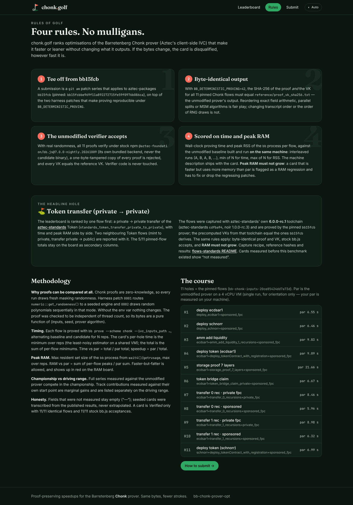                | 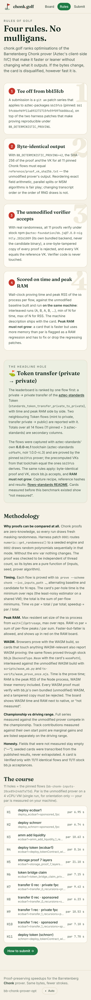                |
| How to submit               | 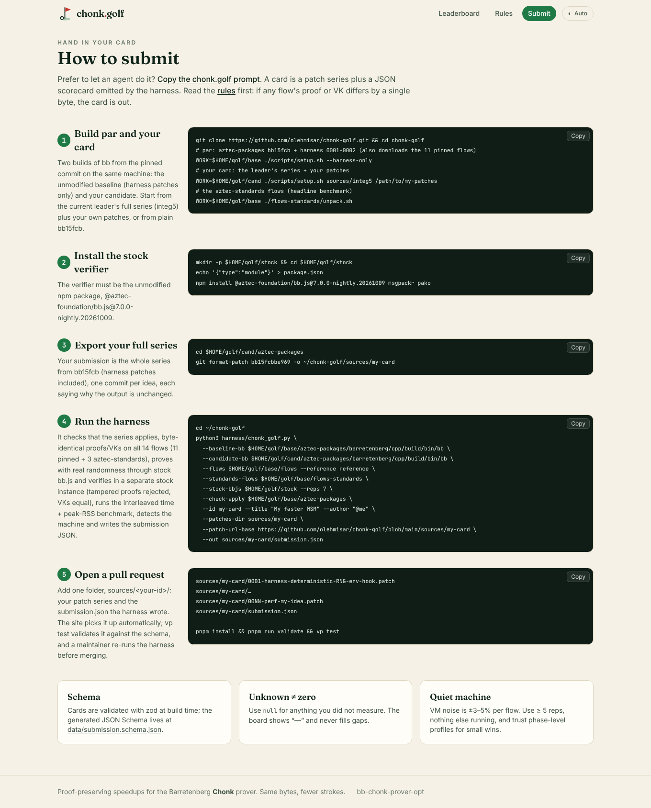               | 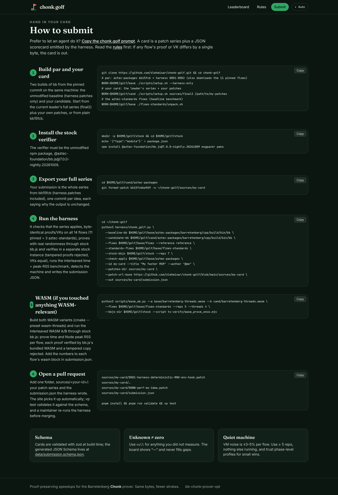               | 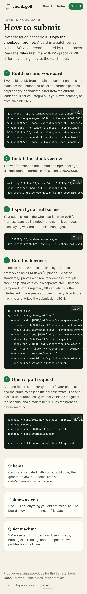               |

## Notes

- zk.golf itself only exposed its title to the fetcher, so the design is from first principles: mowed-fairway hero,
  golf-score deltas (“−24.2%”, “E” for even), scorecard-by-hole tables.
- Chart colours (par = sand `#a8862f`/`#a37b28`, card = fairway `#1f7a45`/`#199e70`) pass the dataviz palette
  validator (lightness, chroma, CVD, contrast) in both themes; bars are also direct-labelled.
- The theme toggle (Auto/Light/Dark) is stored in `localStorage` with a try/catch fallback.
